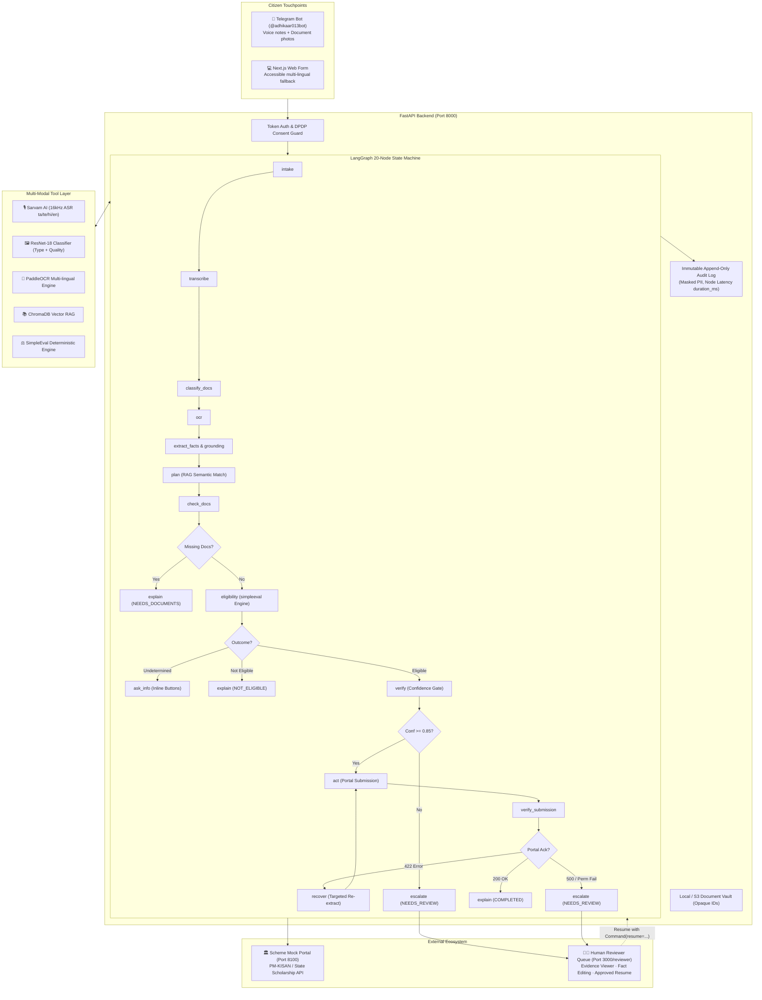
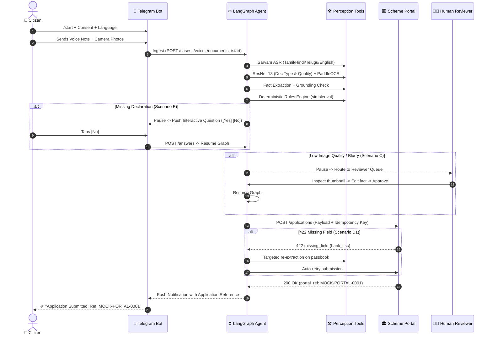

# ADHIKAAR (अधिकार)
### Autonomous Multi-Modal Welfare Entitlement Agent

[](https://github.com/kolatidheeraj013/ADHIKAAR_AI/actions/workflows/ci.yml)
[](LICENSE)
[](pyproject.toml)
[](backend/app/agents/graph.py)
[](docs/eval_report.md)

> **Core Principle:** *The LLM extracts and explains · The deterministic rules engine decides · A human handles doubt.*

**Project in one line:** Adhikaar is an autonomous welfare-entitlement agent. A citizen sends a voice note + document photos on Telegram (web form as fallback); the agent transcribes, classifies and reads the documents, extracts facts, asks follow-up questions, decides eligibility with a **deterministic rules engine**, submits to a (mock) scheme portal, recovers from failures, escalates to a human reviewer when unsure, and records an **audit trail**.

---

## 1. Problem Statement & Existing Gap (ID-01, ID-03)

### The ₹1.5+ Lakh Crore Welfare Exclusion Gap
India spends over ₹4 lakh crore annually on public welfare, yet according to the **Comptroller and Auditor General of India (CAG Report No. 12 of 2022 on Public Welfare Transfers)** and **NITI Aayog (DBT Evaluation Report, 2021)**:
- **₹1.5+ Lakh Crore in Allocated Entitlements Remains Dropped or Unclaimed Annually**, driven by documentation mismatches, complex paperwork, and low functional literacy.
- **Over 40% of Eligible Rural Citizens Abandon Applications** before completion due to procedural confusion and lack of real-time feedback.
- Low-income citizens lose ₹1,500–₹3,000 per application in travel to Common Service Centres (CSCs), lost daily labor wages, and intermediary tout commissions.

### The Existing Gap
Existing platforms like **myScheme.gov.in** and **india.gov.in** are passive discovery directories:
- They tell citizens that a scheme exists, but **do not act**.
- They do not read camera photos of rural documents, cannot transcribe vernacular voice notes, cannot verify mathematical eligibility, cannot auto-fill portal forms, and cannot recover from 422 portal rejections.
- **ADHIKAAR closes the entire loop**: *Voice & Document Photos $\rightarrow$ OCR & Grounding $\rightarrow$ Deterministic Rules $\rightarrow$ Scheme Portal Submission $\rightarrow$ SLA Tracking $\rightarrow$ Human Escalation.*

---

## 2. Target Users (ID-02)

1. **Primary Beneficiaries:**
   - **Rural and Semi-Literate Citizens:** Farmers (PM-KISAN), daily wage earners, and rural women who cannot navigate English/Hindi web portals, but easily send vernacular voice notes on WhatsApp/Telegram.
   - **Elderly Pensioners:** Senior citizens unable to make repeated physical visits to block/tehsil revenue offices.
   - **First-Generation Scholarship Applicants:** Underprivileged students applying for post-matric and merit scholarships without access to desktop computers.
2. **Secondary Stakeholders:**
   - **Grassroots NGOs & Panchayat Frontline Workers:** Operators assisting hundreds of villagers with batch intake and transparent audit histories.
   - **Government Scheme Reviewers:** Frontline caseworkers reviewing only flagged edge cases (12%) through a streamlined evidence dashboard.

---

## 3. Why AI / Agents? (Not a Chatbot Wrapper) (ID-05)

A generic LLM chatbot wrapper fails catastrophically at government welfare: it hallucinates eligibility, cannot reliably parse low-contrast documents, leaks private Aadhaar numbers, and generates invalid portal payloads.

ADHIKAAR uses an **autonomous agent loop** because entitlement realization requires coordinated multi-modal perception, non-linear state planning, deterministic tool execution, and safe escalation:

| Stage | Why AI / Autonomous Agent is Required | Traditional Chatbot Failure Mode |
|---|---|---|
| **Intake** | Normalizes vernacular audio (Tamil, Telugu, Hindi) and debounces photo albums. | Text-only; cannot parse raw audio or image bytes. |
| **Document Perception** | Dual-head ResNet-18 assesses document type and detects blurry/dark camera shots. | Blind to image quality; passes garbage to downstream tools. |
| **Fact Grounding** | LLM extracts schema facts, but a strict algorithmic validator ensures every extracted value matches raw OCR substrings. | Hallucinates plausible names, bank accounts, or hectares. |
| **Eligibility Decision** | **Zero LLM decision-making.** Pure-function `simpleeval` evaluates versioned YAML rules with full rule trace. | Unpredictable, non-deterministic, hallucinates welfare approvals. |
| **Closed-Loop Action** | Formulates API payloads and submits directly to scheme portal with idempotency keys. | Cannot interact with transactional external systems. |
| **Failure Recovery** | On field-level 422 error, agent automatically executes targeted re-extraction on the specific document and retries. | Gives up and forces the citizen to restart from scratch. |
| **Safe Escalation** | Pauses execution with `interrupt()` and routes low-confidence cases to a human reviewer with full evidence. | Either approves illegitimately or silently drops the case. |

---

## 4. System Architecture (ID-04, DC-02)

### High-Level Component Architecture



### Citizen Lifecycle Sequence Flow



---

## 5. Quickstart & Local Reproduction

### Prerequisites
- Python 3.11+
- [uv package manager](https://github.com/astral-sh/uv) (recommended)
- Node.js 18+ (for Next.js web frontend)
- Docker & Docker Compose (optional)

### 1. Run All Tests
Zero network required; 100% offline fixture-based verification:
```bash
# Run full test suite across backend, bot, and portal
uv run --project backend pytest backend/tests/
uv run --project telegram_bot pytest telegram_bot/tests/
uv run --project mock_portal pytest mock_portal/tests/
```

### 2. Run Comprehensive Agent Evaluation (TE-11)
Evaluates 25 synthetic cases across scenarios A, B, C, D1, D2, E, and ineligible rules:
```bash
uv run --project backend python scripts/run_eval.py
# Generates docs/eval_report.md
```

### 3. Generate Fresh Sample Pack (DM-04)
Populates `data/samples/` with SAMPLE-marked images and audio voice notes:
```bash
uv run --project backend python scripts/generate_samples.py
```

### 4. Start Services Locally

**Option A: Docker Compose (All-in-One)**
```bash
docker compose up --build
```

**Option B: Standalone Processes**
```bash
# Terminal 1: Backend API
cd backend && uv run uvicorn app.main:app --port 8000

# Terminal 2: Mock Scheme Portal
cd mock_portal && uv run uvicorn app.main:app --port 8100

# Terminal 3: Telegram Bot (Polling mode)
cd telegram_bot
export TELEGRAM_BOT_TOKEN="your-botfather-token"
export BACKEND_URL="http://127.0.0.1:8000"
export SERVICE_TOKEN="adhikaar-local-service-token"
uv run uvicorn app.main:app --port 8200

# Terminal 4: Next.js Frontend
cd frontend && npm run dev
```

---

## 6. Service Endpoints & Observability

| Service | Endpoint | Purpose |
|---|---|---|
| **Backend** | `GET http://localhost:8000/health` | Rich diagnostics: DB status + Checkpointer readiness |
| **Backend** | `GET http://localhost:8000/stats` | Aggregated system metrics (cases, statuses, avg latency) |
| **Backend** | `POST http://localhost:8000/cases/{id}/track` | Post-submission SLA polling & stall escalation |
| **Backend** | `GET http://localhost:8000/cases/{id}/events` | Real-time Server-Sent Events (SSE) audit stream |
| **Mock Portal** | `GET http://localhost:8100/health` | Portal liveness |
| **Mock Portal** | `POST http://localhost:8100/dev/config` | Flip fail mode (`none`, `timeout`, `reject_permanent`, `stalled`) |
| **Telegram Bot** | `GET http://localhost:8200/health` | Bot service health |
| **Telegram Bot** | `GET http://localhost:8200/ready` | Telegram polling / webhook connectivity status |
| **Reviewer UI** | `http://localhost:3000/reviewer` | Frontline casework evidence dashboard |

---

## 7. Model Weights Distribution (DV-05)

ADHIKAAR uses a lightweight, transfer-learned **ResNet-18** dual-head document classifier (`doc_type` and `quality`).

- **Weights Location:** `backend/app/ml/weights/doc_classifier.pth`
- **Training Script:** `uv run --project backend python ml_training/train.py`
- **Held-Out Evaluation:** Stored in `ml_training/reports/classifier_eval.json`.
- **Heuristic Fallback:** If weights are not downloaded, the engine automatically falls back to an offline heuristic analyzer (`app.ml.classifier:FallbackClassifier`) without crashing.

---

## 8. Pitch & Judging Assets (DC-01 to DC-08)

- 📄 **[One-Page Executive Proposal (Round 2)](docs/proposal.md)** — Problem, Approach, Architecture, and Impact.
- ⏱️ **[5-Minute Presenter Demo Script](docs/demo_script.md)** — Exact screen transitions mapped 1:1 to the hackathon judging rubric.
- 📊 **[Agent Evaluation Report (TE-11)](docs/eval_report.md)** — Empirical 25-case evaluation matrix with 100% agreement and sub-250ms latency.
- 💰 **[Quantified Impact & Value Model](docs/impact.md)** — Mathematical breakdown of time saved, visits avoided, and citizen ROI.
- 📦 **[Pre-Staged Demo Sample Pack](data/samples/README.md)** — Ready-to-test document images and voice files stamped with `SAMPLE`.
- 📋 **[Full Completeness Checklist](checklist.md)** — Complete item-by-item audit and verification log.

---

## 9. Honest Limitations & Ethical Safeguards (ID-08, DC-07)

1. **Synthetic Data Only:** The repository contains zero real citizen PII, zero real Aadhaar numbers, and zero live government credentials. All sample documents are prominently watermarked `SAMPLE — NOT A REAL DOCUMENT`.
2. **Mock Portal & Rules:** Scheme portals and guidelines are configured as `MOCK` demonstrations. Production integration requires formal MoUs and authorized API gateway credentials with state departments.
3. **DPDP Act 2023 Compliance:** Explicit citizen consent is required before document upload (`consent_at`). Any citizen can invoke `/delete` to immediately purge documents, OCR text, and facts from disk and database.
4. **Zero LLM Discretion:** The system guarantees by mathematical construction that generative language models cannot grant or deny welfare entitlements.
