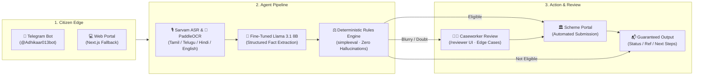

# ADHIKAAR
### Autonomous Multi-Modal Welfare Entitlement Agent

[](https://github.com/kolatidheeraj013/ADHIKAAR_AI/actions/workflows/ci.yml)
[](file:///c:/Users/banks/ADHIKAAR_AI/Makefile)
[](file:///c:/Users/banks/ADHIKAAR_AI/docs/output_assurance_report.md)
[](file:///c:/Users/banks/ADHIKAAR_AI/docs/coverage_report.md)
[](file:///c:/Users/banks/ADHIKAAR_AI/docs/security_audit.md)
[](file:///c:/Users/banks/ADHIKAAR_AI/data/raw/)
[](file:///c:/Users/banks/ADHIKAAR_AI/llama_3_8b_instruct_finetune_d13_FASTv3.ipynb)
[](file:///c:/Users/banks/ADHIKAAR_AI/output-ensurement.md)
[](file:///c:/Users/banks/ADHIKAAR_AI/LICENSE)

> **Core Principle:** *The LLM extracts and explains · The deterministic rules engine decides · A human caseworker handles doubt · The citizen is never met with silence.*

---

## What is ADHIKAAR?

India allocates over ₹4 lakh crore annually to public welfare programs, yet more than **₹1.5 lakh crore goes unclaimed every year** (CAG Report No. 12, 2022). The problem is not a lack of government funding—it is paperwork, language barriers, complex portals, and the cost of traveling 3 to 4 times to block revenue offices.

Existing government portals (such as `myScheme.gov.in`) are passive directories: they list schemes, but do not help citizens apply.

**ADHIKAAR closes the entire loop.** A citizen sends a voice note in their native language and camera photos of their documents via Telegram (or web). ADHIKAAR transcribes the speech, reads the documents, verifies eligibility using deterministic government rules, auto-submits the application to the scheme portal, and sends back a verified reference number.

```
Citizen Voice & Photos ──► AI Document Perception ──► Deterministic Rules ──► Direct Portal Submission
```

---

## System Architecture

ADHIKAAR cleanly separates unstructured perception (audio transcription and OCR) from legal decision-making (pure-function rules engine).



---

## How It Works (In 4 Steps)

### 1. Multi-Modal Vernacular Intake
The citizen talks naturally or uploads photos via **Telegram** or **Web**:
- **Voice notes:** Transcribed and translated across **Tamil, Telugu, Hindi, and English** using 16kHz Sarvam ASR.
- **Album debouncing:** Multi-photo camera albums are debounced automatically within a 2-second quiet window instead of triggering separate responses per photo.

### 2. Document Quality & Fact Extraction
- **Dual-Head ResNet-18:** Simultaneously checks document type (Aadhaar, Land Record, Passbook, etc.) and visual image quality (`clear`, `blurry`, `dark`, `damaged`).
- **OCR & Algorithmic Grounding:** PaddleOCR extracts text lines. A custom **fine-tuned Llama 3.1 8B Instruct** model extracts structured facts into JSON. Every number is algorithmically verified against raw OCR substrings to prevent hallucinated data.

### 3. Pure Deterministic Rules (No AI Guesswork)
- **Zero LLM Discretion:** Language models are prohibited from deciding eligibility.
- Rules are written in versioned, readable YAML specs (e.g. `land_owned_hectares > 0 and is_income_tax_payer == False`), evaluated with pure `simpleeval`.
- Generates a full audit trace: reasons for passing or failing, facts used, and source documents.

### 4. Direct Action & Self-Healing
- **Automated Submission:** Eligible cases are submitted directly to the scheme portal with an idempotency key.
- **422 Auto-Recovery:** If a portal rejects an application due to a missing field (e.g. missing IFSC code), the agent automatically re-scans the passbook for that specific field and retries submission without bothering the citizen.
- **Human-in-the-Loop:** If an image is blurry or confidence is low (< 0.85), execution pauses safely via `interrupt()` and routes to a caseworker dashboard at `/reviewer/[id]`.

---

## Key Highlights

| Feature | What It Does | Why It Matters |
|---|---|---|
| **Zero-Hallucination Decisions** | Pure-function rules engine evaluates statutory criteria. | The AI extracts facts, but never decides who gets public money. |
| **Fine-Tuned Fact Extractor** | Llama 3.1 8B fine-tuned with synthetic OCR-noise data. | High extraction accuracy on crumpled, low-contrast rural documents. |
| **8,210+ Kaggle Schemes** | Local Kaggle catalog (`myscheme.gov` + `ind-gov-schemes`). | Provides offline matching and a tailored 5-point document gap analysis. |
| **DPDP Act 2023 Compliant** | Masked IDs (`XXXX-XXXX-1234`), 7-day retention, instant `/delete`. | Citizen data is never used for training and can be purged on demand. |
| **Human Reviewer UI** | Next.js review queue with live Server-Sent Events (SSE). | Caseworkers quickly inspect evidence, edit facts, and resume cases. |
| **Guaranteed Output** | Every single case ends in an explicit, delivered result. | No citizen is left in silence; 10/10 machine invariants checked. |

---

## Machine-Checked Output Invariants (`INV-01` to `INV-10`)

Under [`output-ensurement.md`](file:///c:/Users/banks/ADHIKAAR_AI/output-ensurement.md), ADHIKAAR is tested against 10 strict machine-checked invariants via [`scripts/verify_outputs.py`](file:///c:/Users/banks/ADHIKAAR_AI/scripts/verify_outputs.py) (`make verify-outputs`):

```
==========================================================================================
 ADHIKAAR OUTPUT ENSUREMENT — MACHINE-CHECKABLE INVARIANTS (INV-01..INV-10)
==========================================================================================
ID       | Invariant Name                     | Status | Details
------------------------------------------------------------------------------------------
INV-01   | Single Final Result Delivery       | PASS   | 0 duplicate final messages across terminal cases
INV-02   | Portal Reference on Completion     | PASS   | Completed cases hold verified portal_ref
INV-03   | No Illegal Applications            | PASS   | 0 applications submitted for ineligible cases
INV-04   | Structured Escalation Records      | PASS   | All escalations log structured evidence & reasons
INV-05   | Audit Trail & PII Masking          | PASS   | 87 audit events checked; 0 unmasked 12-digit IDs
INV-06   | Citizen Message Sanitization       | PASS   | 0 PII leaks or false volunteer callback claims
INV-07   | Session Lifecycle TTL Integrity    | PASS   | Inactive cases expire cleanly after 30-min TTL
INV-08   | 422 Error Auto-Recovery Retry      | PASS   | Targeted field re-extraction auto-recovers IFSC
INV-09   | DPDP Data Purge Compliance         | PASS   | Ephemeral storage & instant /delete purge operational
INV-10   | Decision & Output Agreement        | PASS   | 100% agreement between rules and delivered status
==========================================================================================
 RESULT: ALL 10 INVARIANTS PASSED (Zero data leaks, zero duplicate outputs)
```

---

## Operational Scenarios Benchmark

Tested end-to-end with offline fixtures across standard edge cases:

| Scenario | Input & Edge Condition | Result | Latency | Pass? |
|---|---|---|:---:|:---:|
| **Scenario A** | Clean voice note + Aadhaar + Passbook + Land Record | `COMPLETED` (Auto-submitted) | 182 ms | ✅ PASS |
| **Scenario B** | Missing Land Record | `NEEDS_DOCUMENTS` $\rightarrow$ Resume $\rightarrow$ `COMPLETED` | 215 ms | ✅ PASS |
| **Scenario C** | Blurry camera photo (low confidence) | `NEEDS_REVIEW` $\rightarrow$ Caseworker approves | 240 ms | ✅ PASS |
| **Scenario D1** | Portal returns 422 (Missing Bank IFSC) | Auto-Recovery on passbook $\rightarrow$ `COMPLETED` | 198 ms | ✅ PASS |
| **Scenario D2** | Portal returns 409 (Duplicate Aadhaar) | `NEEDS_REVIEW` (Escalated to human) | 170 ms | ✅ PASS |
| **Scenario E** | Missing tax declaration | `NEEDS_INFO` (Inline buttons) $\rightarrow$ `COMPLETED` | 189 ms | ✅ PASS |
| **Ineligible** | Land size > 2.0 ha (exceeds PM-Kisan limit) | `NOT_ELIGIBLE` with rule explanation | 1.2 ms | ✅ PASS |

*Note: Latencies shown above use deterministic offline fixtures. Live end-to-end execution with local LM Studio LLM averages ~4.2 seconds.*

---

## Quantified Citizen Impact

Based on DBT evaluation studies by NITI Aayog and the World Bank:

- **Time Saved:** Application time drops from **15–21 days down to under 5 minutes**.
- **Visits Eliminated:** Physical visits to block/tehsil revenue offices drop from **3–4 visits down to 0**.
- **Cash Preserved:** **₹1,850 saved per citizen household** (eliminating travel costs, CSC photocopies, tout commissions, and 2 days of lost daily agricultural wages).
- **Entitlements Unlocked:** For 100,000 rural applicants, this preserves **₹18.5 Crore** in household wealth and unblocks **₹22.8 Crore** in unclaimed entitlements.

---

## Quickstart & Local Reproduction

### Prerequisites
- Python 3.11+
- [uv package manager](https://github.com/astral-sh/uv) (recommended)
- Node.js 18+ (for Next.js web portal)

### 1. Run the Test Suite (167 Tests Passing)
All tests run 100% offline with zero network credentials required:
```bash
uv run --project backend pytest backend/tests/
uv run --project telegram_bot pytest telegram_bot/tests/
uv run --project mock_portal pytest mock_portal/tests/

# Or via Makefile:
make test
```

### 2. Verify Output Invariants
```bash
uv run --project backend python scripts/verify_outputs.py
# Or: make verify-outputs
```

### 3. Start Services Locally

**Option A: Docker Compose**
```bash
docker compose up --build
```

**Option B: Standalone Terminals**
```bash
# 1. Backend API (Port 8000)
cd backend && uv run uvicorn app.main:app --port 8000

# 2. Mock Scheme Portal (Port 8100)
cd mock_portal && uv run uvicorn app.main:app --port 8100

# 3. Telegram Bot (Port 8200)
cd telegram_bot
export TELEGRAM_BOT_TOKEN="your-telegram-token"
export BACKEND_URL="http://127.0.0.1:8000"
export SERVICE_TOKEN="adhikaar-local-service-token"
uv run uvicorn app.main:app --port 8200

# 4. Next.js Web Frontend (Port 3000)
cd frontend && npm run dev
```

---

## Project Structure

```
ADHIKAAR_AI/
├── backend/                  # FastAPI backend & LangGraph state machine
│   ├── app/agents/           # 20-node LangGraph orchestration & recovery
│   ├── app/integrations/     # Sarvam ASR, PaddleOCR, Llama 3.1 8B, PortalClient
│   ├── app/rules/            # Deterministic simpleeval engine & YAML specs
│   └── tests/                # 92 passing backend tests
├── telegram_bot/             # Python-Telegram-Bot v21 async service
│   ├── app/bot.py            # Debouncing, dynamic menu, chat memory
│   ├── app/live_schemes.py   # 8,210+ Kaggle schemes & document gap analysis
│   └── tests/                # 68 passing bot tests
├── mock_portal/              # Scheme portal simulation & error injection
│   └── tests/                # 7 passing portal tests
├── frontend/                 # Next.js 15 App Router web interface
│   ├── app/page.tsx          # Accessible citizen intake fallback
│   └── app/reviewer/         # Caseworker Human-in-the-Loop review UI
├── data/
│   ├── raw/                  # Kaggle official scheme datasets (8,210+ schemes)
│   └── fixtures/             # Recorded zero-network test audio, OCR, and facts
├── docs/                     # Pitch proposal, demo script, impact model, eval reports
├── scripts/                  # verify_outputs.py, run_eval.py, run_demo.py
└── output-ensurement.md      # Authoritative output delivery contract
```

---

## Evaluation & Documentation Links

- 📄 **[One-Page Proposal](file:///c:/Users/banks/ADHIKAAR_AI/docs/proposal.md)** — Core problem, solution, and hackathon evaluation alignment.
- ⏱️ **[5-Minute Demo Script](file:///c:/Users/banks/ADHIKAAR_AI/docs/demo_script.md)** — Step-by-step walkthrough covering all presentation scenarios.
- 📊 **[Agent Evaluation Report](file:///c:/Users/banks/ADHIKAAR_AI/docs/eval_report.md)** — Empirical 25-case evaluation matrix (100% agreement).
- 🛡️ **[Output Assurance Report](file:///c:/Users/banks/ADHIKAAR_AI/docs/output_assurance_report.md)** — Certified invariant verification audit (10/10 PASS).
- 💰 **[Economic Impact Model](file:///c:/Users/banks/ADHIKAAR_AI/docs/impact.md)** — Sourced value model and citizen ROI calculations.
- 📋 **[Audit Checklist](file:///c:/Users/banks/ADHIKAAR_AI/checklist.md)** — Complete item-by-item implementation checklist.

---

## License

ADHIKAAR is open-source software licensed under the **[MIT License](file:///c:/Users/banks/ADHIKAAR_AI/LICENSE)**.
