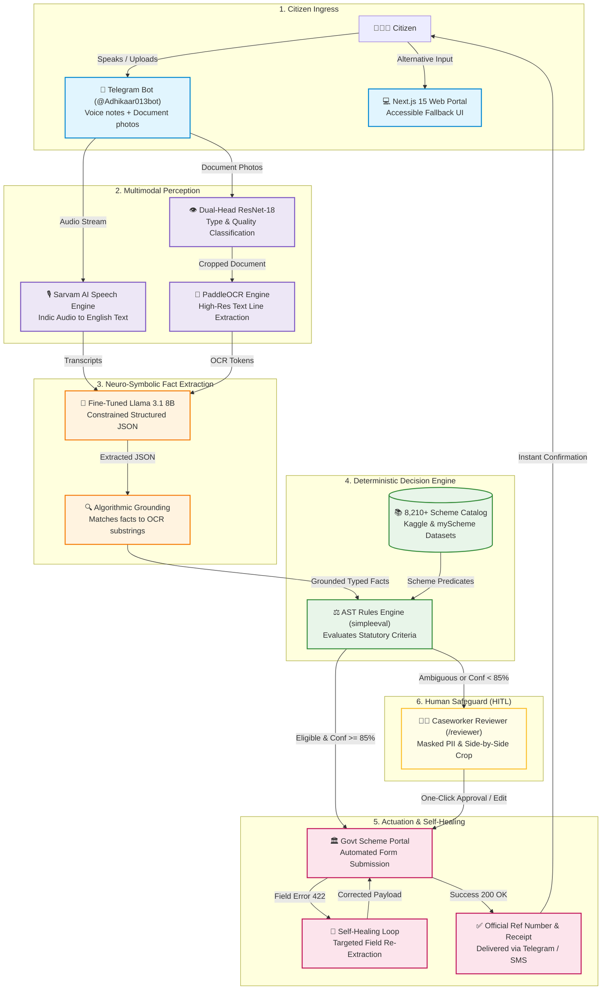
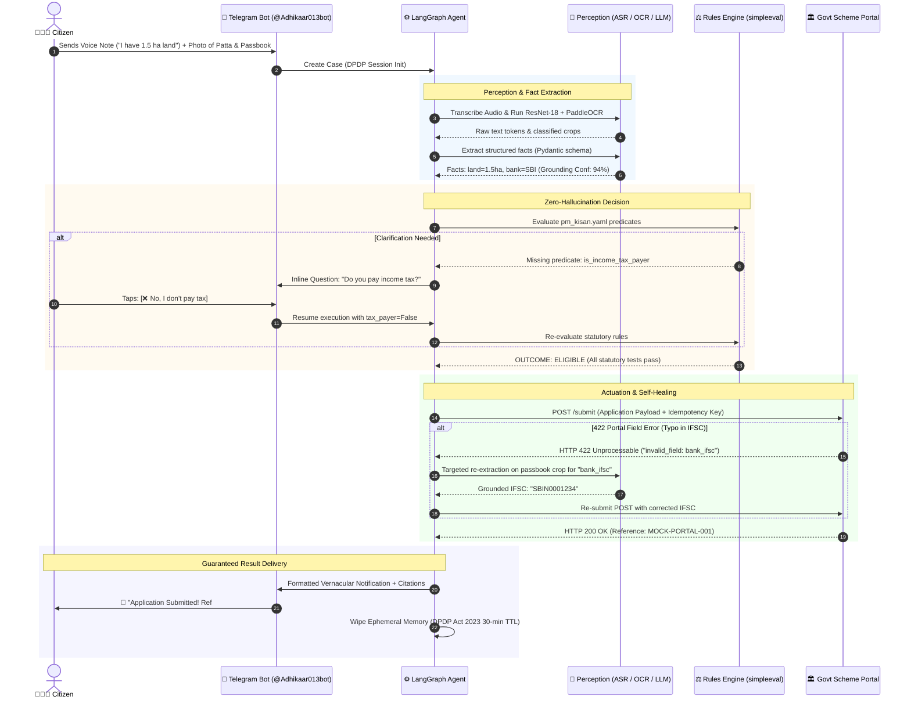

# 🏛️ ADHIKAAR AI — System Architecture & Workflow Guide
### *Autonomous, Zero-Hallucination Multi-Modal Welfare Entitlement Agent*

---

## 🎯 Executive Overview

**ADHIKAAR AI** bridges India's ₹1.5+ Lakh Crore welfare exclusion gap by providing an autonomous, end-to-end pipeline that transforms raw citizen voice notes and smartphone photos of rural documents into verified, submitted government welfare applications.

The architecture enforces a strict **Neuro-Symbolic Separation of Concerns**:
* **Stochastic AI (LLM / Computer Vision / Speech ASR)**: Performs sensory perception, transcription, and structured fact extraction.
* **Deterministic Logic (AST Rules Engine)**: Evaluates statutory welfare eligibility using pure mathematical logic (`simpleeval`) with **zero hallucination risk**.
* **Agentic State Machine (LangGraph)**: Orchestrates 15 discrete nodes with persistent SQLite checkpointing, autonomous 422 self-healing, and Human-in-the-Loop (HITL) review queues.

---

## 🏗️ 1. High-Level End-to-End System Workflow

The following flowchart illustrates how citizen inputs flow from vernacular intake to automated portal submission.



---

## ⚙️ 2. LangGraph State Machine Execution Flow

The internal core of ADHIKAAR AI is a **15-node directed cyclic state graph** defined in [`backend/app/agents/graph.py`](file:///c:/Users/banks/ADHIKAAR_AI/backend/app/agents/graph.py). It manages interruptions, interactive citizen questions, error recovery, and escalation.

```mermaid
flowchart TD
    START([START]) --> intake["1. intake<br/>Initialize CaseState & DPDP Session"]
    
    intake --> transcribe["2. transcribe<br/>Sarvam Indic Speech ASR"]
    transcribe --> classify_docs["3. classify_docs<br/>ResNet-18 Doc Type & Blur Check"]
    classify_docs --> ocr["4. ocr<br/>PaddleOCR Text Token Extraction"]
    ocr --> extract_facts["5. extract_facts<br/>Fine-Tuned Llama 3.1 8B Extraction"]
    extract_facts --> plan["6. plan<br/>Filter Candidate Schemes from 8,210+"]
    plan --> check_docs["7. check_docs<br/>Verify Required Document Presence"]
    
    check_docs -->|Missing Required Documents| explain["15. explain<br/>Generate Vernacular Explanation & Citations"]
    check_docs -->|All Documents Present| eligibility["8. eligibility<br/>AST Rules Engine (simpleeval)"]
    
    eligibility -->|Missing Fact (e.g., Tax Payer?)| ask_info["9. ask_info<br/>Single-Tap Inline Telegram Question"]
    ask_info -->|Citizen Taps Response| eligibility
    
    eligibility -->|Statutorily Ineligible| explain
    eligibility -->|Severe Ambiguity / Error| escalate["14. escalate<br/>Push to Caseworker Queue (/reviewer)"]
    eligibility -->|Eligible Criteria Met| verify["10. verify<br/>Evaluate Grounding Confidence Score"]
    
    verify -->|Confidence 60% - 84%| escalate
    verify -->|Confidence >= 85%| act["11. act<br/>Submit Payload to Govt Portal API"]
    
    act --> verify_submission["12. verify_submission<br/>Inspect Portal HTTP Response Code"]
    
    verify_submission -->|HTTP 200 OK Accepted| explain
    verify_submission -->|HTTP 422 Field Rejection| recover["13. recover<br/>Targeted Single-Field Re-Extraction"]
    
    recover -->|Corrected Field Found| act
    recover -->|Recovery Retries Exhausted| escalate
    
    escalate -->|Caseworker Approves| act
    escalate -->|Caseworker Edits Facts| eligibility
    escalate -->|Caseworker Rejects| explain
    
    explain --> END([END])
```

### LangGraph Node Responsibility Matrix

| Node | Handler Function | Responsibility & Integration |
|---|---|---|
| `intake` | [`intake()`](file:///c:/Users/banks/ADHIKAAR_AI/backend/app/agents/graph.py#L125) | Initializes case state, creates SQLite thread, verifies DPDP consent. |
| `transcribe` | [`transcribe()`](file:///c:/Users/banks/ADHIKAAR_AI/backend/app/agents/graph.py#L160) | Normalizes audio (16kHz mono WAV) and transcribes using Sarvam AI. |
| `classify_docs` | [`classify_docs()`](file:///c:/Users/banks/ADHIKAAR_AI/backend/app/agents/graph.py#L190) | PyTorch Dual-Head ResNet-18 detects document type and flags blur/glare. |
| `ocr` | [`ocr()`](file:///c:/Users/banks/ADHIKAAR_AI/backend/app/agents/graph.py#L225) | PaddleOCR extracts high-resolution text lines and spatial coordinates. |
| `extract_facts` | [`extract_facts()`](file:///c:/Users/banks/ADHIKAAR_AI/backend/app/agents/graph.py#L250) | Fine-tuned Llama 3.1 8B parses OCR tokens into structured Pydantic facts. |
| `plan` | [`plan()`](file:///c:/Users/banks/ADHIKAAR_AI/backend/app/agents/graph.py#L310) | Matches citizen profile against 8,210+ schemes to select candidate ID. |
| `check_docs` | [`check_docs()`](file:///c:/Users/banks/ADHIKAAR_AI/backend/app/agents/graph.py#L340) | Verifies statutory document checklist (e.g., Aadhaar + Patta + Passbook). |
| `eligibility` | [`eligibility()`](file:///c:/Users/banks/ADHIKAAR_AI/backend/app/agents/graph.py#L375) | Evaluates declarative YAML rules using Python's `simpleeval` AST engine. |
| `ask_info` | [`ask_info()`](file:///c:/Users/banks/ADHIKAAR_AI/backend/app/agents/graph.py#L460) | Emits `interrupt()` for single-tap inline button answers on Telegram. |
| `verify` | [`verify()`](file:///c:/Users/banks/ADHIKAAR_AI/backend/app/agents/graph.py#L510) | Validates that grounding confidence meets the $\ge 0.85$ auto-submit threshold. |
| `act` | [`act()`](file:///c:/Users/banks/ADHIKAAR_AI/backend/app/agents/graph.py#L555) | Dispatches signed payload with UUIDv4 Idempotency Key to Portal API. |
| `verify_submission`| [`verify_submission()`](file:///c:/Users/banks/ADHIKAAR_AI/backend/app/agents/graph.py#L595) | Verifies portal confirmation code or flags 422/504 errors. |
| `recover` | [`recover()`](file:///c:/Users/banks/ADHIKAAR_AI/backend/app/agents/graph.py#L640) | Auto-recovery node; prompts LLM for targeted re-extraction of rejected field. |
| `escalate` | [`escalate()`](file:///c:/Users/banks/ADHIKAAR_AI/backend/app/agents/graph.py#L720) | Pauses graph with `interrupt()` and pushes case to Caseworker UI. |
| `explain` | [`explain()`](file:///c:/Users/banks/ADHIKAAR_AI/backend/app/agents/graph.py#L783) | Formats native-language outcome message with citations and reference ID. |

---

## 🔄 3. End-to-End Citizen Lifecycle Sequence

The sequence diagram below walks through a real citizen case, showcasing an interactive clarification and an automated 422 self-healing recovery.



---

## 🛡️ 4. Key Architectural Guarantees

### 1. Neuro-Symbolic Boundary (Zero Hallucination)
> **Core Rule:** *The LLM extracts and explains. The deterministic rules engine decides.*

Statutory welfare rules depend on precise boolean expressions and numerical thresholds. ADHIKAAR AI never asks the LLM *"Is this citizen eligible?"*. Instead, rules are loaded from declarative YAML files ([`data/rulebooks/`](file:///c:/Users/banks/ADHIKAAR_AI/data/rulebooks/)) and computed using Python's `simpleeval` over an Abstract Syntax Tree (AST):
```python
# Evaluated deterministically in < 150ms:
"land_owned_hectares > 0 and land_owned_hectares <= 2.0 and is_income_tax_payer == False"
```

### 2. Autonomous 422 Self-Healing
When government portals reject submissions due to single-field OCR typos (e.g., misreading an `O` for a `0` in an IFSC code), the agent enters the `recover` node. It isolates the rejected field, prompts the fine-tuned LLM with constrained decoding on that specific crop, and resubmits the application without bothering the citizen.

### 3. Human-in-the-Loop (HITL) Confidence Tiers
To ensure safety and legal compliance, every case is routed based on calibrated confidence thresholds:
* **Confidence $\ge 85\%$**: Auto-submitted directly to the government portal.
* **Confidence $60\% - 84\%$**: Graph triggers `interrupt()`; case is routed to the caseworker dashboard at [`frontend/app/reviewer/`](file:///c:/Users/banks/ADHIKAAR_AI/frontend/app/reviewer/).
* **Confidence $< 60\%$**: Escalated for caseworker review or document re-upload request.

### 4. Privacy-by-Design (DPDP Act 2023)
* **Identifier Masking**: Aadhaar numbers and bank accounts are automatically masked (`XXXX-XXXX-1234`) across all logs, telemetry, and reviewer interfaces via [`mask_identifiers()`](file:///c:/Users/banks/ADHIKAAR_AI/backend/app/integrations/llm.py#L29).
* **Ephemeral Storage**: Inactive citizen session memory is automatically purged after a 30-minute TTL.
* **Local Inference**: Runs fine-tuned Llama 3.1 8B locally via LM Studio GGUF (`localhost:1234`), keeping sensitive citizen documents strictly on-premise.

---

## 📂 5. Codebase Component Directory

| Component | Path | Description |
|---|---|---|
| **Citizen Telegram Bot** | [`telegram_bot/app/bot.py`](file:///c:/Users/banks/ADHIKAAR_AI/telegram_bot/app/bot.py) | PTB v21 async service with 2s album debouncing & inline buttons. |
| **Agent Orchestrator** | [`backend/app/agents/graph.py`](file:///c:/Users/banks/ADHIKAAR_AI/backend/app/agents/graph.py) | 15-node LangGraph cyclic graph with SQLite state saver. |
| **State Definitions** | [`backend/app/agents/state.py`](file:///c:/Users/banks/ADHIKAAR_AI/backend/app/agents/state.py) | Typed Pydantic models for CaseState, Facts, Decisions, and Messages. |
| **Rules Engine** | [`backend/app/rules/engine.py`](file:///c:/Users/banks/ADHIKAAR_AI/backend/app/rules/engine.py) | Deterministic AST evaluation engine using `simpleeval`. |
| **Speech Intake (ASR)** | [`backend/app/integrations/sarvam.py`](file:///c:/Users/banks/ADHIKAAR_AI/backend/app/integrations/sarvam.py) | Indic ASR converting regional voice notes to normalized text. |
| **Document Classifier** | [`backend/app/integrations/classifier.py`](file:///c:/Users/banks/ADHIKAAR_AI/backend/app/integrations/classifier.py) | Dual-Head ResNet-18 document type and blur/glare scoring. |
| **OCR Service** | [`backend/app/integrations/ocr.py`](file:///c:/Users/banks/ADHIKAAR_AI/backend/app/integrations/ocr.py) | PaddleOCR extraction with orientation classification. |
| **Fine-Tuned LLM** | [`backend/app/integrations/llm.py`](file:///c:/Users/banks/ADHIKAAR_AI/backend/app/integrations/llm.py) | Llama 3.1 8B client with rate limiting & schema grounding. |
| **Portal Client** | [`backend/app/integrations/portal.py`](file:///c:/Users/banks/ADHIKAAR_AI/backend/app/integrations/portal.py) | Government portal submission gateway with 422 recovery. |
| **Caseworker Dashboard** | [`frontend/app/reviewer/page.tsx`](file:///c:/Users/banks/ADHIKAAR_AI/frontend/app/reviewer/page.tsx) | Next.js review queue with Server-Sent Events (SSE) & masked PII. |
| **Audit Logger** | [`backend/app/audit.py`](file:///c:/Users/banks/ADHIKAAR_AI/backend/app/audit.py) | Immutable append-only audit trail for legal accountability. |

